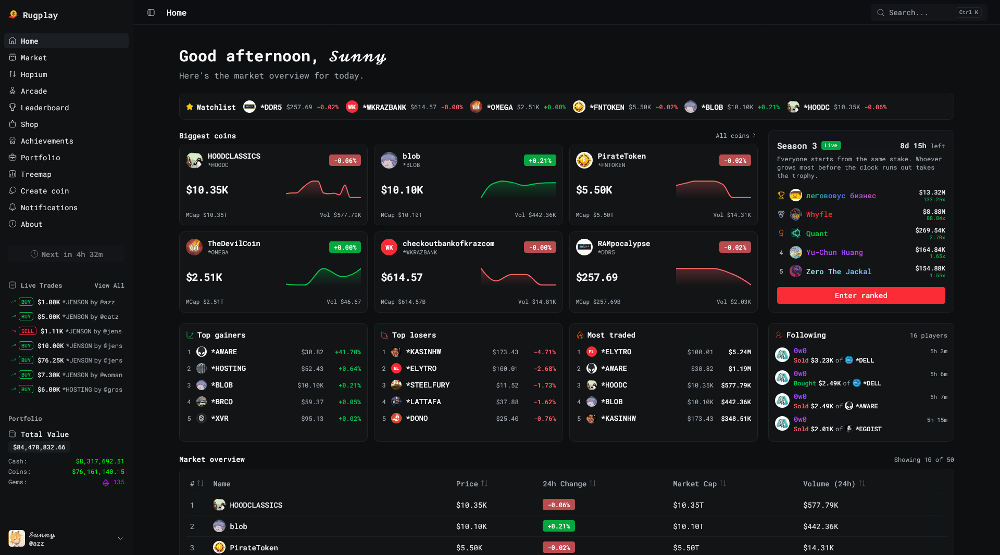
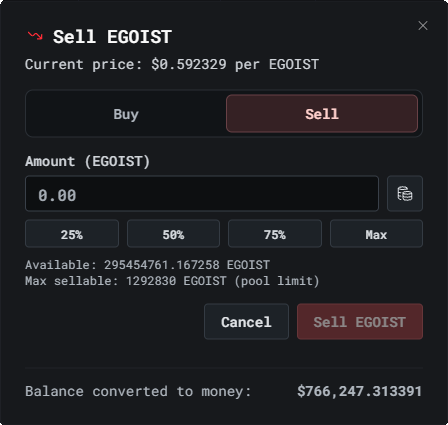

# Sunny Inc. Scripts
 

  

 

  

 

### A collection of scripts(and a theme) for Rugplay

Updated and ported for Sunny Inc.

Credit: Some of the original scripts from https://github.com/bahillybeans/Rugplay-stuff but were modified

I’m not going to explain how to install a Tampermonkey script or a Stylus theme. I’d really rather do anything else, so figure it out yourself.

No I won't fix anything wrong with it that you find Fix it yourself

Didn't include desktop notifications 'cause I'm not that addicted to this game

None of these scripts violate the Rugplay TOS as of writing this November 18th 2026
